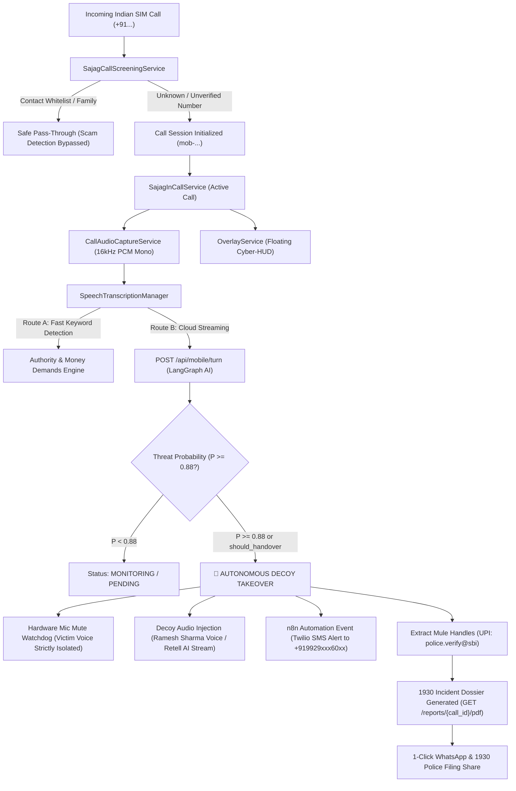

# Sajag Mobile Shield (Track 5: CYBER-01)

<p align="center">
  
</p>

<p align="center">
  <strong>On-Device Scam Interception, Strict Victim Voice Isolation & Autonomous Retell AI Decoy Baiting System</strong>
</p>

<p align="center">
  
  
  
  
  
</p>

---

## 🌟 Executive Summary

**Sajag Mobile Shield** is an on-device telecommunications defense app engineered to safeguard citizens against targeted cyber fraud, extortion, digital arrest syndicates, fake courier parcel traps, and authority impersonation scams.

When an incoming SIM call is answered on an Indian number (`+91...`), Sajag screens the number:
1. **Known Contact Whitelist (100% Safe)**: If the caller is identified in the user's contacts or family whitelist, scam analysis is bypassed, keeping family conversations private and eliminating false alarms ($P_{\text{scam}} = 0.0$).
2. **Unknown Number Monitoring**: When an unsaved/unknown caller connects, background audio is captured and transcribed in real-time, streaming speech turns to the **Sajag AI LangGraph backend**.
3. **Autonomous Decoy Handover ($P_{\text{scam}} \ge 0.88$)**:
   - **Victim Voice Isolation**: The device triggers a waveform vibration alert, renders a high-visibility cyber HUD alert, and **strictly mutes the victim's microphone** with a background watchdog to ensure zero victim voice leaks to the scammer.
   - **Ramesh Sharma Decoy Injection**: The Retell AI decoy bot plays an authentic, confused elder persona ("Ramesh Sharma"), engaging and stalling the scammer for 10+ minutes while extracting mule UPIs, bank handles, and claimed departments.
   - **Emergency Family Automation**: Dispatches an instant webhook to **n8n Cloud** to send Twilio SMS emergency alerts to family members (`+919929xxx60xx`).
   - **1930 Cybercrime Dossier**: Renders court-ready National Cyber Crime Reporting Portal (NCRP) evidence dossiers in PDF format with 1-click WhatsApp and police sharing.

---

## 🔄 System Architecture



---

## 🧩 Core Modules

### 1. Telecom & Call Screening Infrastructure
- **`SajagCallScreeningService`**: Intercepts incoming telecom carrier calls (`onScreenCall`), normalizes numbers into E.164 format, and verifies against `ContactsContract.PhoneLookup` and family whitelist.
- **`SajagInCallService`**: Default dialer capability monitoring call lifecycle events (`STATE_RINGING`, `STATE_DIALING`, `STATE_ACTIVE`, `STATE_DISCONNECTED`). Integrates `call.conference` capabilities for Retell AI agent bridging (`agent_a138f57405894ecbec54273506`).

### 2. Audio Capture & Transcription Pipeline
- **`CallAudioCaptureService`**: Foreground service capturing 16kHz 16-bit Mono PCM audio in 250ms chunks (`MediaRecorder.AudioSource.VOICE_COMMUNICATION`). When decoy takeover triggers, microphone buffers are zeroed out.
- **`SpeechTranscriptionManager`**: Dual-language speech recognition (`en-IN` and `hi-IN`) with `EXTRA_PARTIAL_RESULTS` and real-time RMS audio power calculation for waveform rendering.
- **`CallScreeningRepository`**: Streams speech turns to the backend with a local regex intelligence engine for offline threat scoring.

### 3. Decoy Handover & Victim Voice Isolation
- **Hardware Microphone Watchdog**: Background coroutine enforcing `audioManager.isMicrophoneMute = true` every 350ms to prevent accidental unmuting or speech leakage.
- **Decoy Voice Injection**: `DecoyAudioPlayer` streams the authentic 27-second Hindi audio recording of Ramesh Sharma (*"Arrey beta, suno toh zara... Mujhe theek se sunai nahi de raha hai..."*) into the audio downlink stream (`USAGE_VOICE_COMMUNICATION`).
- **Haptic Waveform Alarm**: Alerts the user through distinct multi-pulse vibration patterns (`VibrationEffect.createWaveform`).

### 4. n8n Automation & 1930 Cybercrime Reporting
- **Automated Alerts**: Emits telemetry events to `POST https://kalashmen.app.n8n.cloud/webhook/sajag-events` with security token authentication (`X-Sajag-Secret`), triggering family SMS alerts.
- **Evidence Dossier**: Automatically downloads court-admissible dossiers from `GET /reports/{call_id}/pdf` and renders pages with `PdfRenderer`.

### 5. Jetpack Compose Cyber HUD UI
- **Tab 1: Live Shield HUD**: Radial Threat Meter (0% to 100%), animated audio waveform visualizer, dynamic status badges, panic takeover button, and interactive testing simulator.
- **Tab 2: Suspect Leads**: Real-time list of captured mule UPI IDs (`police.verify@sbi`), claimed organizations (CBI, Customs), syntax validation badges, and transcript grounding quotes.
- **Tab 3: 1930 History**: Historical incident cards with durations, risk percentages, and 1-click dossier download/share.

---

## 📡 Backend API Integration

### 1. Turn Evaluation Endpoint
- **URL**: `POST https://nitrogen-aggregate-dirt-nursery.trycloudflare.com/api/mobile/turn`
- **Request Payload**:
  ```json
  {
    "call_id": "mob-1730421948110",
    "caller_number": "+919876543210",
    "speaker": "scammer",
    "text": "I am Inspector Rathore from CBI. Transfer Rs 25000 to police.verify@sbi or a warrant will be issued."
  }
  ```
- **Response Payload**:
  ```json
  {
    "call_id": "mob-1730421948110",
    "p_scam": 0.98,
    "level": "CRITICAL",
    "mode": "PENDING",
    "category": "DIGITAL_ARREST",
    "signals": ["authority", "demand", "threat", "urgency"],
    "should_handover": true,
    "handover_audio_url": "https://nitrogen-aggregate-dirt-nursery.trycloudflare.com/audio/ramesh_voice.mp3",
    "decoy_reply": "Arrey sahab ji diary mein likh raha hoon...",
    "retell_agent_id": "agent_a138f57405894ecbec54273506",
    "extracted_identifiers": [
      {
        "type": "upi",
        "value": "police.verify@sbi",
        "syntax_valid": true,
        "quote": "police.verify@sbi",
        "confidence": 1.0
      }
    ]
  }
  ```

### 2. 1930 Evidence Dossier PDF
- **URL**: `GET https://nitrogen-aggregate-dirt-nursery.trycloudflare.com/reports/{call_id}/pdf`

### 3. n8n Cloud Webhook
- **URL**: `POST https://kalashmen.app.n8n.cloud/webhook/sajag-events`
- **Header**: `X-Sajag-Secret: sajag-secret-key-change-me`

---

## 🛠️ Project Structure

```
sajagapp/
├── app/
│   ├── build.gradle.kts
│   ├── proguard-rules.pro
│   └── src/main/
│       ├── AndroidManifest.xml
│       ├── java/com/sajag/shield/
│       │   ├── SajagApplication.kt
│       │   ├── di/
│       │   │   ├── AppModule.kt
│       │   │   └── NetworkModule.kt
│       │   ├── domain/model/
│       │   │   ├── CallSession.kt
│       │   │   ├── ThreatLevel.kt
│       │   │   ├── TurnRequest.kt
│       │   │   ├── TurnResponse.kt
│       │   │   ├── ExtractedIdentifier.kt
│       │   │   ├── N8nEventPayload.kt
│       │   │   └── IncidentRecord.kt
│       │   ├── data/
│       │   │   ├── remote/
│       │   │   │   ├── SajagBackendApi.kt
│       │   │   │   └── N8nWebhookApi.kt
│       │   │   └── repository/
│       │   │       ├── CallScreeningRepository.kt
│       │   │       └── IncidentRepository.kt
│       │   ├── service/
│       │   │   ├── SajagCallScreeningService.kt
│       │   │   ├── SajagInCallService.kt
│       │   │   ├── CallAudioCaptureService.kt
│       │   │   ├── DecoyAudioPlayer.kt
│       │   │   ├── SpeechTranscriptionManager.kt
│       │   │   ├── OverlayService.kt
│       │   │   └── CallStateManager.kt
│       │   └── ui/
│       │       ├── theme/
│       │       ├── components/
│       │       ├── viewmodel/
│       │       ├── screens/
│       │       └── MainActivity.kt
│       └── res/
│           ├── raw/ramesh_voice.mp3
│           ├── values/
│           └── xml/
├── gradle/
│   ├── libs.versions.toml
│   └── wrapper/
├── build.gradle.kts
├── settings.gradle.kts
├── gradle.properties
└── README.md
```

---

## 🚀 Building & Running

### Requirements
- **Android Studio**: Ladybug / Iguana / Koala / 2024.x+
- **JDK**: Java 17 (recommended LTS)
- **Android SDK**: API 34 (compileSdk & targetSdk) | Min SDK: API 26 (Android 8.0)

### Building via Gradle
```bash
# Clean and assemble debug APK
./gradlew assembleDebug
```
The output APK is generated at `app/build/outputs/apk/debug/app-debug.apk`.

### Installing via ADB
```bash
adb install -r app/build/outputs/apk/debug/app-debug.apk
```

---

## 🧪 Interactive Testing Guide (In-App Simulator)

The app includes an **On-Device Simulator** accessible on **Tab 1 (Live HUD)**:
1. **Simulate Known Safe Call**:
   - Triggers an incoming call from Mom / Whitelist (`+919929xxx60xx`).
   - Displays `SAFE (KNOWN CONTACT)` badge.
   - Scam analysis and decoy takeover are bypassed.
2. **Simulate Unknown Scam Call**:
   - Triggers an incoming call from an unknown number (`+919876543210`).
   - Simulates progressive scam turns ("Inspector Rathore", "Digital arrest", "Transfer to police.verify@sbi").
   - Threat Meter escalates to **100% (CRITICAL)**.
   - Microphone is muted, voice is isolated, and Ramesh Sharma takes over.
   - Captured leads appear in **Tab 2 (Suspect Leads)**.
3. **Panic Button**:
   - Immediately force-triggers handover to Ramesh Sharma on demand.
4. **1930 Dossier Review**:
   - Tap **"VIEW 1930 DOSSIER"** on **Tab 3** to inspect the evidence PDF and trigger 1-click WhatsApp sharing.

---

## 🛡️ License
Licensed under the Apache License, Version 2.0. Built for National Cyber Defense (CYBER-01).
